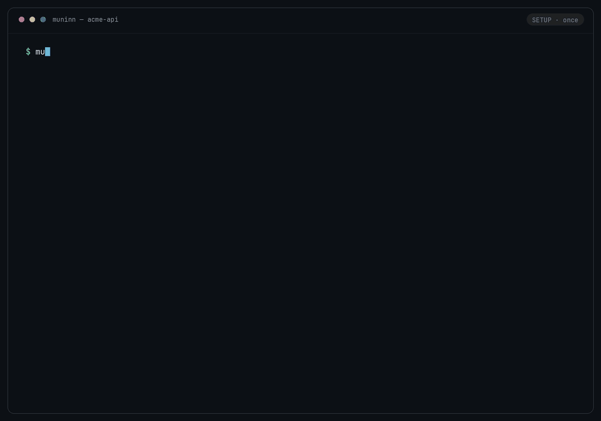
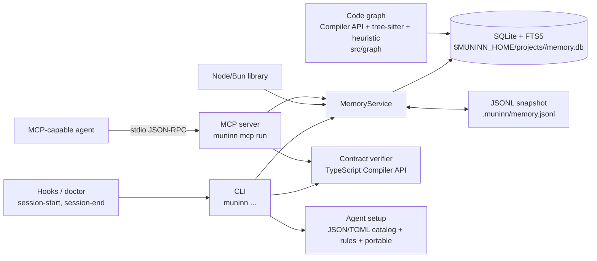

# Muninn

**Local, deterministic memory and a code graph for AI coding agents — one SQLite file, no
embeddings, no network, no server.**

Muninn stores what a coding session learns — architectural decisions, conventions, discoveries,
bugfixes, and the handoff that says where the work stopped — in a portable SQLite store keyed by
a committed project identity. It also indexes the code as a graph (files, symbols, imports, calls,
inheritance, tests) so an agent can ask for the relevant source and call paths instead of reading
the repository. It speaks **MCP**, so any agent can use it, and exposes the same engine as a plain
Node/Bun library and a CLI.

Moving between agents, starting a new session or cloning the project does not lose context: the
next session calls `muninn_bootstrap` and starts from the decisions and the handoff.



*Recorded from the real CLI (absolute paths shortened): session 1 closes with `muninn end-session`;
session 2, in a different agent, calls the brief and reads the handoff and the active decision. No
database server, no embedding API, no network call.*

It used to live inside [Huginn](https://github.com/dahch/huginn); it is now an independent
package with no dependency on the orchestrator.

## Quick Start in 5 minutes

**Goal:** make Cursor — or any MCP-capable agent — remember an architecture decision between
sessions, and start the next session knowing the exact next step.

**You need:** Node.js 20+ (or Bun) and a project. The examples call it `my-app`; use yours.

### 1. Install and create the project identity (1 min)

```sh
npm install -g @dahch/muninn
cd ~/code/my-app
muninn memory init --project .
```

```text
✔ Muninn memory database initialized
  Database: ~/.muninn/projects/p-1f3c9a7e0b2d4c6a8e0f/memory.db
  Project:  my-app (/home/you/code/my-app)
  UID:      p-1f3c9a7e0b2d4c6a8e0f
  Marker:   /home/you/code/my-app/.muninn/project.json
  Status:   Tables ready
```

Commit `.muninn/project.json`. It is the uid that keeps memory attached if the repository moves,
is cloned or is checked out on another machine; the database itself stays outside the checkout.

### 2. Register Muninn with your agent (1 min)

```sh
muninn setup --agent cursor --project "$PWD"
```

Swap `cursor` for `claude`, `codex`, `opencode`, `dsh` or any other id from `muninn setup --list`.
Setup merges only the `muninn` entry, leaves the rest of the configuration untouched and installs
a marked rules block in the agent's rules file. Restart the agent so it loads the MCP server.

### 3. Settle a decision (1 min)

In the agent, ask for something concrete:

> Use SQLite with WAL for the counters and remember why.

The agent calls `muninn_save` with category `decision` and a topic key such as `storage`; saving
another decision with the same topic key supersedes the old one atomically. The rules block that
`setup` installed is what tells the agent to save here instead of losing the reasoning in chat.

### 4. Close the session (1 min)

When the work stops, ask:

> Write the handoff: what you did, what remains and the next step.

or write it from the terminal, where `end-session` can also fill branch and changed files from Git:

```sh
muninn end-session \
  --goal "Counters on SQLite" \
  --state "WAL enabled; migration pending" \
  --next "write migration;add tests"
```

### 5. Start the next session anywhere (1 min)

In a new session — the same agent or a different one — the agent calls `muninn_bootstrap`, which
is what the rules block asks for. The handoff is rendered before decisions, so budget truncation
cannot hide the point where the work stopped:

```text
# Session Brief: my-app

## Where we left off
- Goal: Counters on SQLite
- State: WAL enabled; migration pending

### Next steps
1. write migration
2. add tests

## Active Decisions

### Topic: storage
- **Use SQLite with WAL for counters** `[decision]`
  ...
```

No MCP in that runtime? `muninn memory brief` prints the same Markdown. That is the whole loop:
save a decision, write a handoff, read the brief. Seeding, the code graph and the optional
tree-sitter pack sit on top of the same store and never change this contract.

## Why Muninn

- **Local and deterministic.** One SQLite file, no server, no embeddings, no network. Search is
  FTS5 + BM25 over a stemmed, diacritic-folded index, with prefix and trigram fallbacks for the
  questions a strict conjunction would miss; the same input always produces the same brief and the
  same graph.
- **Identity that survives movement.** A committed uid (with Git remote and path fallbacks) keeps
  memory attached across moves, clones, worktrees and machines; memory lives outside the checkout,
  so it never dirties `git status`.
- **Continuity first.** The active handoff — goal, state, next steps, open questions — renders at
  the top of a bounded session brief (8k chars by default), so a new agent starts where the last
  one stopped without reading the repository.
- **A graph you can trust.** Derived, incremental and content-addressed. TypeScript/JavaScript use
  the Compiler API; ten more languages use optional tree-sitter WASM grammars and a deterministic
  heuristic fallback covers everything else, so no project is a blank graph. Every edge carries
  confidence and resolution. Freshness is reported, not assumed: the brief, `muninn_project status`
  and `muninn doctor` say when the graph is stale, and the MCP server refreshes it incrementally
  (debounced, bounded, `MUNINN_AUTO_INDEX=0` to disable) before answering graph questions.
- **One engine, three surfaces.** The library, the CLI and the MCP server share `MemoryService`,
  the same storage rules and the same output contracts; thirteen MCP tools cover memory, graph,
  handoff and contract verification.
- **Agent-agnostic activation.** `initialize` instructions, per-agent rules files (a marked block in
  shared files, a dedicated file where the agent supports one), opt-in hooks and `muninn doctor`
  explain and fix why an agent is not seeing the memory, without assuming any one agent's format.

## Overview

- **Observations with categories** — `decision`, `convention`, `discovery`, `bugfix`,
  `architecture` — searchable with SQLite **FTS5 + BM25** ranking. Queries run in tiers (exact
  conjunction, prefix `OR`, trigram substring) and results are compact by default: identity, rank
  and a short excerpt, with `detail: "full"` for whole bodies.
- **Decision supersession** — saving a decision with `supersedesTopicKey` atomically marks the
  project's active decisions with that topic key as `superseded`, linking each to its replacement.
  Search and context hide superseded observations by default; pass `includeSuperseded` to see them.
- **Read-only session brief** — the library, MCP `muninn_bootstrap` tool, and
  `muninn memory brief` render the same deterministic Markdown view of project identity, active
  decisions, recent activity, path-selected indexed symbols, related graph neighbors, and counts.
  Bootstrap reads an existing database without DDL or project insertion and fails open when memory
  is missing or unusable.
- **A code graph** — files, symbols (functions, methods, classes, interfaces, types, structs,
  traits and more) and the `imports`, `calls`, `extends`, `implements`, `references` and `contains`
  edges between them, with line spans, signatures and confidence. Test files are flagged, so
  `muninn_graph tests <file>` reports the tests affected by a change. TypeScript and
  JavaScript are parsed with the Compiler API; other languages use optional tree-sitter WASM
  grammars (Python, Go, Rust, Java, C, C++, C#, Ruby, PHP, Bash) when `web-tree-sitter` and
  `@vscode/tree-sitter-wasm` are installed, and a deterministic heuristic scan otherwise — so no
  project is a blank graph and the index never requires the optional pack. Indexing is incremental
  and content-addressed.
- **Graph-aware recovery** — `MemoryService.neighbors` traverses stored dependency edges in both
  directions, grouped by relation and direction, with deduplication, cycle protection, depth at most
  2 (default 1), and at most 50 neighbors (default 20). Briefs expand these neighbors by default,
  and `muninn_inspect_symbol` adds a bounded depth-1 traversal.
- **MCP tools** for agents: `muninn_bootstrap`, `muninn_explore`, `muninn_graph`,
  `muninn_code_search`, `muninn_handoff`, `muninn_project`, `muninn_save`, `muninn_search`,
  `muninn_context`, `muninn_link_symbol`, `muninn_inspect_symbol`, `muninn_stats`,
  `muninn_verify_contract`.
- **Contract verification** — the same TypeScript execution-contract check as a CLI command
  (`muninn check`) and as the `muninn_verify_contract` MCP tool.
- **JSONL sync** — export/import the whole memory as portable line-delimited JSON.
- **Agent setup** — `muninn setup` lists the supported agent catalog and installs a `muninn` MCP
  entry into standard `mcpServers`, OpenCode `mcp`, and Codex TOML configurations, plus the
  project-agnostic portable file at `{home}/.muninn/mcp.json`. It supports `--agent`, `--project`,
  `--list`, `--status`, `--dry-run`, `--force`, `--home`, and `--no-rules`, preserves unrelated
  configuration, and never modifies the legacy Huginn file. Codex TOML is merged safely, and selected
  agents receive an idempotent rules block with legacy-block detection; destinations with a native
  rules slot (Claude Code, Devin) get a dedicated file instead of a block inside a shared one.
- **Local-first and self-contained** — no embeddings, no network, no server: one SQLite file
  and one process.

## Prerequisites

- Node.js 20 or newer (the published package also runs under Bun)
- A C/C++ toolchain for `better-sqlite3`'s native module when a prebuilt binary is unavailable
- Git only if you want repository discovery and sanitized remote metadata; Muninn works outside a repository
- Optional: `web-tree-sitter` and `@vscode/tree-sitter-wasm` (installed as optional dependencies) for
  AST-precise extraction of non-TypeScript languages; without them the
  [heuristic engine](#how-precise-is-each-extraction-tier) is used

## Installation

```sh
npm install -g @dahch/muninn     # CLI + MCP server
# or as a library
npm install @dahch/muninn
```

The [Quick Start](#quick-start-in-5-minutes) covers a global install end to end. From a checkout,
install the locked dependencies, build and initialize memory for this repository:

```sh
npm ci
npm run build
node dist/cli.js memory init --project .
```

## CLI

```sh
muninn memory init   [--db <path>] [--project <path>] [--no-marker]
muninn memory search <query> [--category <cat>] [--limit <n>] [--project <path>]
muninn memory sync   [--import] [--file <path>] [--project <path>]
muninn memory index  [files...] [--project <path>] [--db <path>]
muninn memory brief  [--project <path>] [--paths a,b] [--budget <n>] [--db <path>]
muninn memory handoff [status|--goal <t> --state <s>|--close]

muninn seed [--project <path>] [--dry-run] [--json]
muninn index [--project <path>] [--full] [--watch] [--json] [--max-files <n>] [--exclude a,b] [--no-treesitter]
muninn graph <relation> <symbol|file> [--depth <n>] [--limit <n>] [--json]
muninn end-session [--goal <t>] [--state <s>] [--next "a;b"] [--question "x;y"]

muninn hook <session-start|session-end> [--project <path>] [--budget <n>] [--json]
            [--goal <t>] [--state <s>] [--next "a;b"] [--question "x;y"] [--agent <name>]
muninn hooks <status|install|uninstall> [--home <path>] [--dry-run] [--force]
muninn snapshot [--project <path>] [--file <path>] [--db <path>]
muninn restore [--project <path>] [--file <path>] [--db <path>]

muninn project resolve [path] [--json]
muninn project list [--json]
muninn project register [path]
muninn project rename <name> [--project <path>]
muninn project forget <uid|path> [--purge --force]
muninn migrate [--from <db>] [--scan <dir>] [--dry-run] [--json]
muninn doctor [--project <path>] [--json]

muninn check [files...] [--project <path>]

muninn mcp run [--db <path>] [--project <path>]

muninn setup [--list] [--agent <id|all|id,id>] [--project <path>] [--home <path>]
             [--components <mcp,rules,portable|all>] [--portable|--no-portable]
             [--no-rules] [--force] [--dry-run] [--status]
```

Identity lives in `<project>/.muninn/project.json` (commit it: it is the uid that makes memory
survive a move, a clone or another machine). Memory lives in `$MUNINN_HOME/projects/<uid>/memory.db`
(default `~/.muninn`), one file per project whether or not it is a Git repository, and the code
graph lives next to it. `--db` overrides the file; `:memory:` is accepted for tests.
`MUNINN_LEGACY_STORAGE=1` restores the pre-0.3 `.huginn` layout, and `muninn migrate` moves old
databases into the portable store without touching them.

`muninn memory brief` is read-only. `--paths` accepts up to 20 comma-separated files or directories
(relative to the project root, or absolute inside it) and selects only indexed symbols. `--budget`
limits the complete Markdown output to a positive integer no greater than 20,000 characters; the
default is 8,000. Briefs expand dependency neighbors by default; `getSessionBrief({ expandGraph:
false })` and MCP `expandGraph` / `expand_graph` disable that section. If the selected symbols have no
stored dependencies, the section is omitted and a note explains why. A missing, inaccessible, or
corrupt database yields an empty brief with an explanatory note instead of being created or repaired.

## MCP

Register Muninn with any MCP-capable agent. For example, a Claude Code / Codex / Cursor config
(`mcpServers`):

```json
{
  "mcpServers": {
    "muninn": {
      "command": "muninn",
      "args": ["mcp", "run", "--project", "/absolute/path/to/repo"]
    }
  }
}
```

OpenCode uses the same shape under the `mcp` key with `"type": "local"` and a `command` array.

```sh
muninn mcp run --project .
```

`muninn setup --list` shows every supported destination and where its configuration lives. With
`--agent`, setup merges the `muninn` entry into the selected destinations (JSON or Codex TOML), installs
marked usage rules unless `--no-rules` is given, and includes the portable file unless `--no-portable`
is given; `--project` supplies the absolute project path used by project-contained configuration files
and rules. Codex TOML merging is supported with safe atomic writes and read-only diagnostics.

The `muninn_save` tool accepts `supersedesTopicKey` / `supersedes_topic_key`, and
`muninn_search` / `muninn_context` accept `includeSuperseded` / `include_superseded`. Existing
calls keep working: replacement is opt-in and retrieval excludes superseded observations by
default.

`muninn_bootstrap` optionally accepts `paths` (at most 20), `budgetChars` / `budget_chars`
(default 8,000, maximum 20,000), and `expandGraph` / `expand_graph` (default `true`, disabling the
related-symbol expansion). It returns the shared service-rendered Markdown directly, not a JSON
wrapper, and does not create or initialize a database when called on a default server.

## Agent Setup

`muninn setup` manages the portable destination `{home}/.muninn/mcp.json` and the JSON- and
TOML-format agent destinations in the catalog.

Nothing is installed that was not selected: `--components` takes any of `mcp`, `rules` and
`portable` (default: all three), and `--no-rules` / `--no-portable` narrow the same selection.
Hooks are never installed by `setup`; they are the separate, opt-in `muninn hooks install`.

```sh
muninn setup --list                              # print the catalog without writing
muninn setup                                     # write/merge the portable entry
muninn setup --agent cursor,pi --project .       # configure selected agents + portable
muninn setup --agent all --project .             # every catalog destination + portable
muninn setup --agent opencode --components mcp   # MCP entry only: no rules, no portable
muninn setup --agent claude --components mcp,rules --project .  # MCP entry + rules file
muninn setup --agent opencode --no-portable      # only the selected destination
muninn setup --agent cursor --no-rules           # configure without installing rules
muninn setup --status --agent claude --project . # selected agents + portable, read-only
muninn setup --dry-run --agent all --project .   # report intended actions without writing
```

The catalog is `cursor`, `claude`, `opencode`, `devin`, `qwen`, `codex`, `agy`, `kimi`, `pi`,
`commandcode`, `omp`, `mcode`, `mimo`, and `dsh`. DSH Desktop is a **manual** destination: it stores MCP
servers inside its `dsh-mcp` plugin rather than in a config file, so setup prints the steps instead of
writing (install `dsh-mcp` in the profile, then add Muninn from its MCP UI). Path templates expand `{project}`, `{home}`, and
`{opencodeConfigDir}`; `MUNINN_AGENT_<ID>_MCP_PATH` (colon-separated) overrides a target's paths, and
`HUGINN_AGENT_<ID>_MCP_PATH` is accepted as an equivalent fallback. `MUNINN_OPENCODE_CONFIG_DIR`
overrides the OpenCode config directory (`HUGINN_OPENCODE_CONFIG_DIR` is the fallback). Project-contained
config files get `--project <absolute path>`; shared user-level and portable files never pin a project.

Standard entries are `{ "command": "muninn", "args": ["mcp", "run"] }` under `mcpServers.muninn`.
OpenCode uses `{ "type": "local", "command": ["muninn", "mcp", "run"], "enabled": true }` under
`mcp.muninn`. Setup merges only the Muninn entry, preserves unrelated keys and servers, and leaves the
legacy `{home}/.huginn/mcp.json` untouched (it only reports it when present).

Diagnostic states are `absent`, `registered`, `legacy`, `conflict`, and `malformed`. A conflicting
entry, or a JSON target whose existing entry still invokes the legacy `huginn` command (`legacy`), is
skipped without `--force`. For the portable file, `legacy` means the portable config is missing while
`{home}/.huginn/mcp.json` exists: setup writes the portable entry and only reports the legacy file.
Malformed JSON, a non-regular file, a final-component symlink, or a protected path fails with exit
code 1. Writes are atomic, new files use mode `0o600`, new parent directories use `0o700`, and existing
permissions are preserved. Re-running setup over a correct entry is byte-for-byte idempotent and
reports `changed: false`. `--list`, `--status`, and `--dry-run` never create or modify files,
directories, or temporary files.

Codex uses a dependency-free TOML writer that merges `[mcp_servers.muninn]`, preserves unrelated
tables and keys, and applies the same conflict, permission, atomic-write, and symlink rules as JSON
destinations. A forced replacement can discard comments and formatting inside the replaced Muninn
region; unrelated content outside it is preserved where feasible. Malformed TOML, including duplicate
table definitions, is reported with its path and cause, leaves the original untouched, and status
continues to inspect the remaining destinations before exiting 1.

Selected agents receive the same guidance in the form their catalog entry declares. Shared files
(`AGENTS.md`, `QWEN.md`, `.cursorrules`) get a Markdown block delimited by
`<!-- muninn:rules:start -->` and `<!-- muninn:rules:end -->`; destinations with a native rules slot
get a dedicated file Muninn owns end to end — `.claude/rules/muninn.md` for Claude Code (v2.1.211+,
with `CLAUDE.md` as the documented fallback for older versions) and
`.windsurf/rules/muninn.md` for Devin. The rules recommend `muninn_bootstrap` at session start (it carries the active
decisions and the last handoff), `muninn_search` / `muninn_explore` / `muninn_graph` before designing a
change, `muninn_save` for anything settled, `muninn_handoff` before finishing, `muninn_project` with
action `index` when the graph is stale, and `muninn_verify_contract` before completing code.
Setup appends the block to an existing rules file, creates the file only when a write is needed, and
replaces only its own marked block on later runs. Agents that share a rules file (for example the
various `AGENTS.md` destinations) receive one deduplicated block. Without `--agent`, rules are neither
read nor written; `--no-rules` suppresses them for an explicit selection.

A prior `<!-- huginn:muninn-rules:start -->` block is reported as `stale` and left byte-identical
without `--force`; with `--force` it is replaced while surrounding prose is preserved. Unmatched,
duplicate, unterminated, crossed, or nested managed/legacy markers are fatal and leave the file
untouched. Rules paths use the same containment and symlink checks as MCP configuration, and writes
preserve existing permissions or use `0o600` for new files. Status reports `absent`, `present`, `stale`,
or `malformed` per rules file and identifies the selected agents that share it; normal setup and dry-run
report `written`, `present`, `stale`, or `failed`. A selected agent binary missing from `PATH` produces
a nonfatal `not installed` warning and does not change the exit code. Targets with no meaningful local
executable (`cursor`, `devin`) are not probed and never warn.

## Portable memory, handoffs and the code graph

**Identity and storage.** A project is identified by the uid in `.muninn/project.json`, falling
back to the Git remote and then the resolved path. Every worktree of a repository shares one
identity; every non-Git directory gets its own storage. Memory and graph live under
`$MUNINN_HOME/projects/<uid>/`, so moving or cloning the project does not orphan them.

**Handoffs.** `muninn_handoff` records the goal, current state, files touched, next steps, open
questions and blockers. The active handoff is rendered **first** in `muninn_bootstrap`, so a new
session in a different agent starts from it. `muninn end-session` fills the mechanical parts
(branch, changed files, last commit) automatically.

**Global memory.** An observation saved with `scope: "global"` goes to a separate cross-project
store and appears in every project's brief under "Global preferences". `muninn_search` and
`muninn_context` accept `includeGlobal` to consult it explicitly; the default stays project-local.

**Portability.** `muninn snapshot` writes a deterministic `.muninn/memory.jsonl` inside the
repository (commit it if you want memory to travel with the repo); `muninn restore` merges it back
by observation id on any machine.

**Seeding.** `muninn seed` turns the repository's own structured knowledge into memory: the README
overview, build/test commands, a language and directory map, the agent conventions and every ADR.
It is deterministic and idempotent, and never invents facts.

**Code graph.** `muninn index` builds or refreshes the graph incrementally; `--watch` keeps it
fresh while you edit, and `--no-treesitter` forces the heuristic engine for a run. In a Git work tree the file list comes from Git (so `.gitignore` is exact);
outside Git the walker reads `.gitignore` itself. Agents query it through `muninn_explore` (source
+ callers + callees + related decisions), `muninn_graph` (node, callers, callees, impact,
implementations, imports, cycles, tests, files) and `muninn_code_search`.

**DSH Desktop sessions.** DSH mounts an MCP server once per profile, so the server has no
per-session cwd. With `MUNINN_SESSION_AUTODETECT=dsh` (set in the server's `env`), Muninn follows
the newest DSH session's working directory: if it is a project (marker or Git), it binds
automatically; if it is a workspace containing several repositories, `muninn_bootstrap` lists them
and the agent selects one with `muninn_project { action: "use" }`. Create the DSH workspace at a
project root to make the binding fully automatic.

**Activation.** The MCP `initialize` response carries project-aware instructions, and
`muninn setup` installs rules that ask for `muninn_bootstrap`, `muninn_save` and `muninn_handoff`.
Agents that support hooks can run `muninn hook session-start` (prints the brief),
`muninn hook session-end` (writes the handoff from git state) and `muninn hook after-edit` (refreshes
the code graph); the contract is a command, so no per-agent format is assumed. `muninn hooks install
--agent claude --scope user|project` merges those commands into the matching settings file (opt-in,
idempotent, and it never replaces unrelated hooks or settings). Outside a hook, the MCP server itself
keeps the graph fresh before answering graph questions. `muninn doctor` explains why an agent is not
seeing the memory:
missing entry, legacy `huginn` command, a pinned `--project`, or a runtime without MCP support
(DSH Desktop reports this until an MCP plugin is installed in its profile).

### How precise is each extraction tier?

The graph never hides its fidelity: every symbol records its line span and every edge carries
`confidence` (`exact` or `heuristic`) and `resolution` (`resolved`, `ambiguous`, `external`,
`unresolved`). Three engines produce those rows:

| What you get | TS/JS (Compiler API) | Optional tree-sitter pack | Heuristic fallback |
|---|---|---|---|
| Symbols | declarations with body spans, kinds, heritage | declarations with body spans, kinds, heritage | name, kind and signature from per-language line patterns |
| Symbol span | `startLine`–`endLine` cover the body | cover the body | the declaration line only |
| Nesting (`Class.method`) | exact | exact | class association where the family allows it; Python methods are plain functions |
| Imports | AST specifiers, resolved to files where the resolution pass can | AST specifiers, same resolution pass | common `import` / `from` / `use` / `require` / `#include` forms; Python and Ruby relative imports resolve to files |
| Calls | call sites with the local declaration in scope | call expressions | any `name(` token outside a declaration line, attributed to the last shallower declaration |
| Call target | same file, then project-unique name; else `ambiguous`/`unresolved` | same | same; duplicate names become `ambiguous`, unknown names stay `unresolved` |
| Docstrings / doc comments | JSDoc where present | comments where present | preceding `#` / `//` / `--` comment lines (Python docstrings are not read) |

In practice:

- **Symbols and imports** are dependable for straightforward module/class code. A Python file
  with `class CounterService`, three `def`s and `from app.store import CounterStore` yields the
  class, the functions and one resolved import; `.config` stays `external` when no file matches.
- **Calls are a recall-oriented hint, not a verified call graph.** Member calls
  (`self.store.get(name)`) are attributed by the bare name, so a same-named symbol elsewhere can
  be selected, and chained, computed or aliased calls can be missed. Treat `calls` edges from the
  fallback as "this name appears in the body", then confirm with `muninn_explore`.
- **Spans stop at the declaration line**, so a fallback symbol's source slice shows the signature,
  not the body. Nesting and visibility are best effort.

If exact bodies, call receivers and docstrings matter for Python, Rust, Go or another supported
language (Python, Go, Rust, Java, Kotlin, C, C++, C#, Ruby, PHP, Swift, Dart, Scala, Lua, Bash,
SQL, Vue/Svelte/Astro), add the local pack — still no network at runtime:

```sh
npm install --save-optional web-tree-sitter @vscode/tree-sitter-wasm
muninn index --full
```

Without the pack nothing breaks: the fallback is deterministic (the same bytes always produce the
same rows), bounded at 4,000 symbols and 4,000 edges per file, and its rows are labelled
`heuristic` so you can judge an edge before trusting it.

## Architecture

Muninn is one `MemoryService` core with three adapters: the CLI, the MCP stdio server, and the
library. Storage is a single embedded SQLite database with FTS5. The AST indexer writes through the
service/database boundary; contract verification is a separate read-only TypeScript pass.



See [`DESIGN.md`](./DESIGN.md) for the schema, service transactions, MCP validation pipeline, CLI
parsing, contract verifier and indexer internals.

## Library

```ts
import { MemoryService, indexFilesIntoMuninn } from "@dahch/muninn";

const memory = new MemoryService({ projectRoot: process.cwd() });

memory.saveObservation({
  category: "decision",
  title: "Auth is a port",
  content: "Tokens are validated behind an AuthPort so the transport can change.",
  topicKey: "auth-boundary",
  symbols: ["src/auth/port.ts"],
});

// Replaces earlier active decisions with the same topic key in this project.
memory.saveObservation({
  category: "decision",
  title: "Auth is a middleware boundary",
  content: "Tokens are validated in middleware before any handler runs.",
  topicKey: "auth-boundary",
  supersedesTopicKey: "auth-boundary",
});

// Superseded decisions are hidden unless explicitly requested.
const history = memory.search({
  query: "token validation",
  includeSuperseded: true,
});

indexFilesIntoMuninn(memory, ["src/auth/port.ts"], { projectRoot: process.cwd() });

for (const hit of memory.search({ query: "token validation", limit: 5 })) {
  console.log(hit.category, hit.title, hit.rank);
}

// The same bounded Markdown used by the MCP tool and CLI.
const brief = memory.getSessionBrief({ paths: ["src/auth"], budgetChars: 8000 });
console.log(brief.markdown);

// Bounded, deterministic dependency neighbors (depth max 2, limit max 50).
const graph = memory.neighbors("src/auth/port.ts::TokenValidator", { depth: 2 });
console.log(graph?.groups);

memory.close();
```

For bootstrap without initializing anything, use the standalone read-only entry point:

```ts
import { readSessionBrief } from "@dahch/muninn";

const brief = readSessionBrief({
  projectRoot: process.cwd(),
  paths: ["src/service"],
  budgetChars: 8000,
});
console.log(brief.markdown);
```

Subpath entry points are available for narrower imports:

| Import | Contents |
|---|---|
| `@dahch/muninn` | everything below |
| `@dahch/muninn/db` | SQLite client, schema, path resolution, project records |
| `@dahch/muninn/service` | `MemoryService` (save, search, context, linking, sync, stats, session brief, graph neighbors) |
| `@dahch/muninn/indexer` | AST symbol/dependency extraction and indexing |
| `@dahch/muninn/mcp` | MCP server, tool registry, bounded stdio transport |
| `@dahch/muninn/contracts` | TypeScript contract verification |
| `@dahch/muninn/util` | terminal-text sanitizer |

## Environment Variables

Muninn has no required environment variables. Configuration is passed as CLI flags or
`MemoryService` options.

| Variable | Type | Default | Purpose |
|---|---|---|---|
| `MUNINN_HOME` | directory path | `~/.muninn` | Root of the portable store (registry, per-project databases, graph indexes). |
| `MUNINN_SESSION_AUTODETECT` | `dsh` | unset | Follow the newest DSH session's working directory: bind automatically when it is a project, or list the projects inside a workspace. |
| `DSH_HOME` | directory path | `~/.dsh` | Used by `MUNINN_SESSION_AUTODETECT=dsh` to locate the session cache. |
| `MUNINN_LEGACY_STORAGE` | `1` | unset | Restore the pre-0.3 `.huginn` database resolution (migration work only). |
| `MUNINN_TREESITTER` | `0` | unset | Force Tier C heuristic extraction for every language instead of loading the optional tree-sitter WASM pack (`--no-treesitter` does the same for one run). |
| `MUNINN_DEBUG` | string (presence is enough) | unset | Emit the `[muninn] mcp run: stdin closed by the client; shutting down.` diagnostic on stderr when the parent closes stdin. |
| `HUGINN_DEBUG` | string (presence is enough) | unset | Legacy alias for `MUNINN_DEBUG`, retained for Huginn compatibility. |
| `MUNINN_AGENT_<ID>_MCP_PATH` | string (colon-separated paths) | the catalog paths for that agent | Replace a setup target's MCP configuration paths. `<ID>` is the uppercase agent ID, for example `MUNINN_AGENT_CURSOR_MCP_PATH`; an all-empty override is rejected. |
| `HUGINN_AGENT_<ID>_MCP_PATH` | string (colon-separated paths) | unset | Legacy fallback for `MUNINN_AGENT_<ID>_MCP_PATH`, retained for Huginn compatibility. |
| `MUNINN_OPENCODE_CONFIG_DIR` | string (directory path) | `{home}/.config/opencode` | Directory used to expand the OpenCode target's `{opencodeConfigDir}` marker. |
| `HUGINN_OPENCODE_CONFIG_DIR` | string (directory path) | unset | Legacy fallback for `MUNINN_OPENCODE_CONFIG_DIR`, retained for Huginn compatibility. |
| `PATH` | string (platform path list) | inherited | Used by `muninn setup --agent` to detect each selected agent's executable for the nonfatal `not installed` warning. |
| `PATHEXT` | string (semicolon-separated extensions, Windows only) | `.EXE;.CMD;.BAT;.COM` | Windows executable extensions used by the same lookup; ignored on other platforms. |

## Security notes

- Session bootstrap opens an existing database read-only. It never creates a directory or file, runs
  DDL/migrations, or inserts a project row; path selections are confined to the project root.
- Every path Muninn writes to — the SQLite file and the JSONL export — is screened: a symlink on
  the final component is refused, and a project-relative path must resolve inside the project, so
  a repository cannot redirect the write outside itself (the `src/util/path-safety.ts` rule, with
  the tests in `test/db.test.ts` and `test/service.test.ts`).
- The MCP stdio transport is bounded and survives a dead parent instead of crashing or hanging.
- MCP tool inputs are validated with zod; unknown tools and bad arguments fail closed.
- Setup screens its config and legacy paths with the path-safety helper, refuses a final-component
  symlink, merges only the `muninn` entry, and writes through an exclusive temporary file + atomic
  rename. Neither `--status` nor `--dry-run` creates files or directories.

## Available Scripts

```sh
npm run dev        # run src/cli.ts directly with Bun
npm run build      # tsc -> dist/ (+ schema.sql, +x cli.js)
npm test           # vitest run (storage, service, session brief, graph, indexer, MCP, CLI, contracts, setup)
npm run test:watch # vitest in watch mode
npm run typecheck  # tsc --noEmit
npm run prepublishOnly  # build + test + typecheck (npm lifecycle hook)
```

Run the built CLI without installing it globally:

```sh
node dist/cli.js memory init --project .
node dist/cli.js memory search "auth boundary" --project .
```

### Releasing

Publishing is tag-driven, but only once the package exists. The **first** publish is manual, from a
logged-in machine, because npm's trusted publishing attaches to a package page that has to exist first:

```sh
npm login
npm run build && npm publish   # 0.1.0, once
```

After that, configure the trusted publisher on npm (repository `dahch/muninn`, workflow
`publish.yml`) and tagged releases need no token at all: `git tag v0.1.1 && git push origin v0.1.1`
runs the workflow, which checks the tag against `package.json`, builds, tests and publishes over
OIDC. A run whose version is already on npm skips the publish step and refreshes the GitHub release
instead, so re-tagging to fix a message stays safe. The release job copies the matching version
section from [`CHANGELOG.md`](./CHANGELOG.md).

## Project Structure

```text
src/
  cli.ts                 argument parsing, command routing, process entry point
  commands/              memory (init/search/sync/index/brief), mcp run, check, setup
  db/                    SQLite client, schema.sql, migrations, project records
  project/               portable identity: marker, registry, Git worktrees, storage paths
  graph/                 code graph: discovery, extraction, incremental indexing, queries
  commands/              memory, project, migrate, seed, index/graph, handoff, doctor, mcp, check, setup
  service/               MemoryService: save, search, context, links, sync, stats, brief, handoffs, neighbors
  indexer/               legacy AST symbol and dependency extraction (kept for compatibility)
  mcp/                   MCP server, tool registry, Zod schemas, bounded stdio transport
  contracts/             in-process TypeScript contract verification
  setup/                 agent catalog/path resolution, JSON/TOML target merge, marked rules
                         install/diagnose, and portable MCP install/diagnose
  util/                  terminal-text sanitizer and path-safety helpers
test/                    Vitest integration suites for db, service, session brief, graph, indexer, MCP, CLI, contracts, setup
```

## Documentation

- [`SPEC.md`](./SPEC.md) — product behaviour, domain model, use cases and constraints.
- [`DESIGN.md`](./DESIGN.md) — technical design, schema, data flow and internals.
- [`ADR.md`](./ADR.md) — architecture decision records and their implementation status.
- [`CHANGELOG.md`](./CHANGELOG.md) — release notes.
- [`plan.md`](./plan.md) — staged plan for the agent-setup work.
- [`ROADMAP.md`](./ROADMAP.md) — the portable-memory and code-graph roadmap with completion state.
- [`AGENTS.md`](./AGENTS.md) — repository conventions for coding agents; no `.opencode/agents/` are defined.
- [`docs/media/README.md`](./docs/media/README.md) — how the animated README demo is recorded and
  regenerated from real CLI output.

## Contributing

Keep changes aligned with the current contract: update both `src/db/schema.sql` and the `SCHEMA_SQL`
fallback in `src/db/client.ts`, add or update a Vitest suite under `test/`, and run
`npm run build && npm test && npm run typecheck` before opening a pull request. Add a new ADR for a
new architectural decision instead of rewriting an existing one.

All repository artifacts — documentation, code comments, commit messages, pull-request titles and
descriptions, and release notes — are written in English.

## License

MIT © Daniel Hernández
