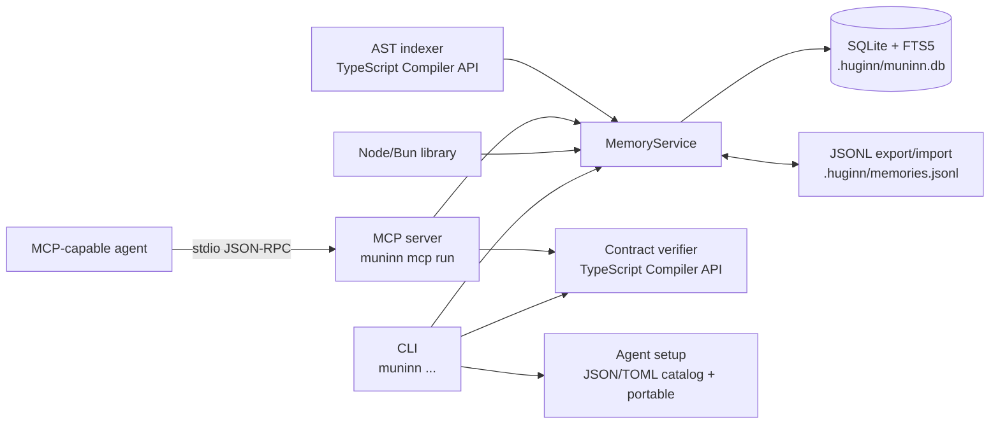

# Muninn

Persistent **semantic and symbol memory** for AI coding agents.

Muninn stores the things a coding session learns — architectural decisions, conventions,
discoveries, bugfixes — next to the symbols they refer to, in a single SQLite file that lives
with the project. It speaks **MCP** so any agent can save and query it, and it exposes the same
engine as a plain Node/Bun library and a CLI.

It used to live inside [Huginn](https://github.com/dahch/huginn); it is now an independent
package with no dependency on the orchestrator.

## Overview

- **Observations with categories** — `decision`, `convention`, `discovery`, `bugfix`,
  `architecture` — searchable with SQLite **FTS5 + BM25** ranking.
- **Decision supersession** — saving a decision with `supersedesTopicKey` atomically marks the
  project's active decisions with that topic key as `superseded`, linking each to its replacement.
  Search and context hide superseded observations by default; pass `includeSuperseded` to see them.
- **Read-only session brief** — the library, MCP `muninn_bootstrap` tool, and
  `muninn memory brief` render the same deterministic Markdown view of project identity, active
  decisions, recent activity, path-selected indexed symbols, related graph neighbors, and counts.
  Bootstrap reads an existing database without DDL or project insertion and fails open when memory
  is missing or unusable.
- **A symbol graph** — the TypeScript Compiler API extracts files, functions, classes,
  interfaces and modules from your sources, plus the `imports`/`extends`/`implements`/
  `references` edges between them, and links observations to symbols. The schema also reserves a
  `calls` relation, but the current indexer does not emit call edges.
- **Graph-aware recovery** — `MemoryService.neighbors` traverses stored dependency edges in both
  directions, grouped by relation and direction, with deduplication, cycle protection, depth at most
  2 (default 1), and at most 50 neighbors (default 20). Briefs expand these neighbors by default,
  and `muninn_inspect_symbol` adds a bounded depth-1 traversal.
- **MCP tools** for agents: `muninn_context`, `muninn_save`, `muninn_search`,
  `muninn_link_symbol`, `muninn_inspect_symbol`, `muninn_verify_contract`, `muninn_stats`,
  `muninn_bootstrap`.
- **Contract verification** — the same TypeScript execution-contract check as a CLI command
  (`muninn check`) and as the `muninn_verify_contract` MCP tool.
- **JSONL sync** — export/import the whole memory as portable line-delimited JSON.
- **Agent setup** — `muninn setup` lists the supported agent catalog and installs a `muninn` MCP
  entry into standard `mcpServers`, OpenCode `mcp`, and Codex TOML configurations, plus the
  project-agnostic portable file at `{home}/.muninn/mcp.json`. It supports `--agent`, `--project`,
  `--list`, `--status`, `--dry-run`, `--force`, `--home`, and `--no-rules`, preserves unrelated
  configuration, and never modifies the legacy Huginn file. Codex TOML is merged safely, and selected
  agents receive an idempotent marked rules block with legacy-block detection.
- **Local-first and self-contained** — no embeddings, no network, no server: one SQLite file
  and one process.

## Prerequisites

- Node.js 20 or newer (the published package also runs under Bun)
- A C/C++ toolchain for `better-sqlite3`'s native module when a prebuilt binary is unavailable
- Git only if you want repository discovery and sanitized remote metadata; Muninn works outside a repository

## Getting Started

```sh
npm install -g @dahch/muninn     # CLI + MCP server
# or as a library
npm install @dahch/muninn
```

From a checkout, install the locked dependencies and initialize memory for this repository:

```sh
npm ci
npm run build
node dist/cli.js memory init --project .
```

## CLI

```sh
muninn memory init   [--db <path>] [--project <path>]
muninn memory search <query> [--category <cat>] [--limit <n>] [--project <path>]
muninn memory sync   [--import] [--file <path>] [--project <path>]
muninn memory index  [files...] [--project <path>] [--db <path>]
muninn memory brief  [--project <path>] [--paths a,b] [--budget <n>] [--db <path>]

muninn check [files...] [--project <path>]

muninn mcp run [--db <path>] [--project <path>]

muninn setup [--list] [--agent <id|all|id,id>] [--project <path>] [--home <path>]
             [--portable|--no-portable] [--no-rules] [--force] [--dry-run] [--status]
```

The database resolves to `<git-root>/.huginn/muninn.db` inside a repository and to
`~/.huginn/muninn.db` outside one. `--db` overrides it; `:memory:` is accepted for tests.
Both the database file and the project record are resolved from the **same** root, so
`--project X` can never write into another project's database.

`muninn memory brief` is read-only. `--paths` accepts up to 20 comma-separated files or directories
(relative to the project root, or absolute inside it) and selects only indexed symbols. `--budget`
limits the complete Markdown output to a positive integer no greater than 20,000 characters; the
default is 8,000. Briefs expand dependency neighbors by default; `getSessionBrief({ expandGraph:
false })` and MCP `expandGraph` / `expand_graph` disable that section. If the selected symbols have no
stored dependencies, the section is omitted and a note explains why. A missing, inaccessible, or
corrupt database yields an empty brief with an explanatory note instead of being created or repaired.

## MCP

Register Muninn with any MCP-capable agent. For example, a Claude Code / Codex / Cursor config
(`mcpServers`):

```json
{
  "mcpServers": {
    "muninn": {
      "command": "muninn",
      "args": ["mcp", "run", "--project", "/absolute/path/to/repo"]
    }
  }
}
```

OpenCode uses the same shape under the `mcp` key with `"type": "local"` and a `command` array.

```sh
muninn mcp run --project .
```

`muninn setup --list` shows every supported destination and where its configuration lives. With
`--agent`, setup merges the `muninn` entry into the selected destinations (JSON or Codex TOML), installs
marked usage rules unless `--no-rules` is given, and includes the portable file unless `--no-portable`
is given; `--project` supplies the absolute project path used by project-contained configuration files
and rules. Codex TOML merging is supported with safe atomic writes and read-only diagnostics.

The `muninn_save` tool accepts `supersedesTopicKey` / `supersedes_topic_key`, and
`muninn_search` / `muninn_context` accept `includeSuperseded` / `include_superseded`. Existing
calls keep working: replacement is opt-in and retrieval excludes superseded observations by
default.

`muninn_bootstrap` optionally accepts `paths` (at most 20), `budgetChars` / `budget_chars`
(default 8,000, maximum 20,000), and `expandGraph` / `expand_graph` (default `true`, disabling the
related-symbol expansion). It returns the shared service-rendered Markdown directly, not a JSON
wrapper, and does not create or initialize a database when called on a default server.

## Agent Setup

`muninn setup` manages the portable destination `{home}/.muninn/mcp.json` and the JSON- and
TOML-format agent destinations in the catalog.

```sh
muninn setup --list                              # print the catalog without writing
muninn setup                                     # write/merge the portable entry
muninn setup --agent cursor,pi --project .       # configure selected agents + portable
muninn setup --agent all --project .             # every catalog destination + portable
muninn setup --agent opencode --no-portable      # only the selected destination
muninn setup --agent cursor --no-rules           # configure without installing rules
muninn setup --status --agent claude --project . # selected agents + portable, read-only
muninn setup --dry-run --agent all --project .   # report intended actions without writing
```

The catalog is `cursor`, `claude`, `opencode`, `devin`, `qwen`, `codex`, `agy`, `kimi`, `pi`,
`commandcode`, `omp`, `mcode`, and `mimo`. Path templates expand `{project}`, `{home}`, and
`{opencodeConfigDir}`; `MUNINN_AGENT_<ID>_MCP_PATH` (colon-separated) overrides a target's paths, and
`HUGINN_AGENT_<ID>_MCP_PATH` is accepted as an equivalent fallback. `MUNINN_OPENCODE_CONFIG_DIR`
overrides the OpenCode config directory (`HUGINN_OPENCODE_CONFIG_DIR` is the fallback). Project-contained
config files get `--project <absolute path>`; shared user-level and portable files never pin a project.

Standard entries are `{ "command": "muninn", "args": ["mcp", "run"] }` under `mcpServers.muninn`.
OpenCode uses `{ "type": "local", "command": ["muninn", "mcp", "run"], "enabled": true }` under
`mcp.muninn`. Setup merges only the Muninn entry, preserves unrelated keys and servers, and leaves the
legacy `{home}/.huginn/mcp.json` untouched (it only reports it when present).

Diagnostic states are `absent`, `registered`, `legacy`, `conflict`, and `malformed`. A conflicting
entry, or a JSON target whose existing entry still invokes the legacy `huginn` command (`legacy`), is
skipped without `--force`. For the portable file, `legacy` means the portable config is missing while
`{home}/.huginn/mcp.json` exists: setup writes the portable entry and only reports the legacy file.
Malformed JSON, a non-regular file, a final-component symlink, or a protected path fails with exit
code 1. Writes are atomic, new files use mode `0o600`, new parent directories use `0o700`, and existing
permissions are preserved. Re-running setup over a correct entry is byte-for-byte idempotent and
reports `changed: false`. `--list`, `--status`, and `--dry-run` never create or modify files,
directories, or temporary files.

Codex uses a dependency-free TOML writer that merges `[mcp_servers.muninn]`, preserves unrelated
tables and keys, and applies the same conflict, permission, atomic-write, and symlink rules as JSON
destinations. A forced replacement can discard comments and formatting inside the replaced Muninn
region; unrelated content outside it is preserved where feasible. Malformed TOML, including duplicate
table definitions, is reported with its path and cause, leaves the original untouched, and status
continues to inspect the remaining destinations before exiting 1.

Selected agents also receive a Markdown rules block delimited by `<!-- muninn:rules:start -->` and
`<!-- muninn:rules:end -->`. It recommends `muninn_bootstrap` at session start, `muninn_search` and
`muninn_inspect_symbol` before designing a change, and `muninn_verify_contract` before completing code.
Setup appends the block to an existing rules file, creates the file only when a write is needed, and
replaces only its own marked block on later runs. Agents that share a rules file (for example the
various `AGENTS.md` destinations) receive one deduplicated block. Without `--agent`, rules are neither
read nor written; `--no-rules` suppresses them for an explicit selection.

A prior `<!-- huginn:muninn-rules:start -->` block is reported as `stale` and left byte-identical
without `--force`; with `--force` it is replaced while surrounding prose is preserved. Unmatched,
duplicate, or unterminated managed/legacy markers are fatal and leave the file untouched. Rules paths
use the same containment and symlink checks as MCP configuration, and writes preserve existing
permissions or use `0o600` for new files. Status reports `absent`, `present`, or `stale` per rules file
and identifies the selected agents that share it; normal setup and dry-run report `written`, `present`,
`stale`, `skipped`, or `failed`. A selected agent binary missing from `PATH` produces a nonfatal `not
installed` warning and does not change the exit code.

## Architecture

Muninn is one `MemoryService` core with three adapters: the CLI, the MCP stdio server, and the
library. Storage is a single embedded SQLite database with FTS5. The AST indexer writes through the
service/database boundary; contract verification is a separate read-only TypeScript pass.



See [`DESIGN.md`](./DESIGN.md) for the schema, service transactions, MCP validation pipeline, CLI
parsing, contract verifier and indexer internals.

## Library

```ts
import { MemoryService, indexFilesIntoMuninn } from "@dahch/muninn";

const memory = new MemoryService({ projectRoot: process.cwd() });

memory.saveObservation({
  category: "decision",
  title: "Auth is a port",
  content: "Tokens are validated behind an AuthPort so the transport can change.",
  topicKey: "auth-boundary",
  symbols: ["src/auth/port.ts"],
});

// Replaces earlier active decisions with the same topic key in this project.
memory.saveObservation({
  category: "decision",
  title: "Auth is a middleware boundary",
  content: "Tokens are validated in middleware before any handler runs.",
  topicKey: "auth-boundary",
  supersedesTopicKey: "auth-boundary",
});

// Superseded decisions are hidden unless explicitly requested.
const history = memory.search({
  query: "token validation",
  includeSuperseded: true,
});

indexFilesIntoMuninn(memory, ["src/auth/port.ts"], { projectRoot: process.cwd() });

for (const hit of memory.search({ query: "token validation", limit: 5 })) {
  console.log(hit.category, hit.title, hit.rank);
}

// The same bounded Markdown used by the MCP tool and CLI.
const brief = memory.getSessionBrief({ paths: ["src/auth"], budgetChars: 8000 });
console.log(brief.markdown);

// Bounded, deterministic dependency neighbors (depth max 2, limit max 50).
const graph = memory.neighbors("src/auth/port.ts::TokenValidator", { depth: 2 });
console.log(graph?.groups);

memory.close();
```

For bootstrap without initializing anything, use the standalone read-only entry point:

```ts
import { readSessionBrief } from "@dahch/muninn";

const brief = readSessionBrief({
  projectRoot: process.cwd(),
  paths: ["src/service"],
  budgetChars: 8000,
});
console.log(brief.markdown);
```

Subpath entry points are available for narrower imports:

| Import | Contents |
|---|---|
| `@dahch/muninn` | everything below |
| `@dahch/muninn/db` | SQLite client, schema, path resolution, project records |
| `@dahch/muninn/service` | `MemoryService` (save, search, context, linking, sync, stats, session brief, graph neighbors) |
| `@dahch/muninn/indexer` | AST symbol/dependency extraction and indexing |
| `@dahch/muninn/mcp` | MCP server, tool registry, bounded stdio transport |
| `@dahch/muninn/contracts` | TypeScript contract verification |
| `@dahch/muninn/util` | terminal-text sanitizer |

## Environment Variables

Muninn has no required environment variables. Configuration is passed as CLI flags or
`MemoryService` options.

| Variable | Type | Default | Purpose |
|---|---|---|---|
| `MUNINN_DEBUG` | string (presence is enough) | unset | Emit the `[muninn] mcp run: stdin closed by the client; shutting down.` diagnostic on stderr when the parent closes stdin. |
| `HUGINN_DEBUG` | string (presence is enough) | unset | Legacy alias for `MUNINN_DEBUG`, retained for Huginn compatibility. |
| `MUNINN_AGENT_<ID>_MCP_PATH` | string (colon-separated paths) | the catalog paths for that agent | Replace a setup target's MCP configuration paths. `<ID>` is the uppercase agent ID, for example `MUNINN_AGENT_CURSOR_MCP_PATH`; an all-empty override is rejected. |
| `HUGINN_AGENT_<ID>_MCP_PATH` | string (colon-separated paths) | unset | Legacy fallback for `MUNINN_AGENT_<ID>_MCP_PATH`, retained for Huginn compatibility. |
| `MUNINN_OPENCODE_CONFIG_DIR` | string (directory path) | `{home}/.config/opencode` | Directory used to expand the OpenCode target's `{opencodeConfigDir}` marker. |
| `HUGINN_OPENCODE_CONFIG_DIR` | string (directory path) | unset | Legacy fallback for `MUNINN_OPENCODE_CONFIG_DIR`, retained for Huginn compatibility. |

## Security notes

- Session bootstrap opens an existing database read-only. It never creates a directory or file, runs
  DDL/migrations, or inserts a project row; path selections are confined to the project root.
- Every path Muninn writes to — the SQLite file and the JSONL export — is screened: a symlink on
  the final component is refused, and a project-relative path must resolve inside the project, so
  a repository cannot redirect the write outside itself (the `src/util/path-safety.ts` rule, with
  the tests in `test/db.test.ts` and `test/service.test.ts`).
- The MCP stdio transport is bounded and survives a dead parent instead of crashing or hanging.
- MCP tool inputs are validated with zod; unknown tools and bad arguments fail closed.
- Setup screens its config and legacy paths with the path-safety helper, refuses a final-component
  symlink, merges only the `muninn` entry, and writes through an exclusive temporary file + atomic
  rename. Neither `--status` nor `--dry-run` creates files or directories.

## Available Scripts

```sh
npm run dev        # run src/cli.ts directly with Bun
npm run build      # tsc -> dist/ (+ schema.sql, +x cli.js)
npm test           # vitest run (storage, service, session brief, graph, indexer, MCP, CLI, contracts, setup)
npm run test:watch # vitest in watch mode
npm run typecheck  # tsc --noEmit
npm run prepublishOnly  # build + test + typecheck (npm lifecycle hook)
```

Run the built CLI without installing it globally:

```sh
node dist/cli.js memory init --project .
node dist/cli.js memory search "auth boundary" --project .
```

### Releasing

Publishing is tag-driven, but only once the package exists. The **first** publish is manual, from a
logged-in machine, because npm's trusted publishing attaches to a package page that has to exist first:

```sh
npm login
npm run build && npm publish   # 0.1.0, once
```

After that, configure the trusted publisher on npm (repository `dahch/muninn`, workflow
`publish.yml`) and tagged releases need no token at all: `git tag v0.1.1 && git push origin v0.1.1`
runs the workflow, which checks the tag against `package.json`, builds, tests and publishes over
OIDC. A run whose version is already on npm skips the publish step and refreshes the GitHub release
instead, so re-tagging to fix a message stays safe. The release job copies the matching version
section from [`CHANGELOG.md`](./CHANGELOG.md).

## Project Structure

```text
src/
  cli.ts                 argument parsing, command routing, process entry point
  commands/              memory (init/search/sync/index/brief), mcp run, check, setup
  db/                    SQLite client, schema.sql, path and project resolution
  service/               MemoryService: save, search, context, links, sync, stats, brief, neighbors
  indexer/               TypeScript/JavaScript AST symbol and dependency extraction
  mcp/                   MCP server, tool registry, Zod schemas, bounded stdio transport
  contracts/             in-process TypeScript contract verification
  setup/                 agent catalog/path resolution, JSON/TOML target merge, marked rules
                         install/diagnose, and portable MCP install/diagnose
  util/                  terminal-text sanitizer and path-safety helpers
test/                    Vitest integration suites for db, service, session brief, graph, indexer, MCP, CLI, contracts, setup
```

## Documentation

- [`SPEC.md`](./SPEC.md) — product behaviour, domain model, use cases and constraints.
- [`DESIGN.md`](./DESIGN.md) — technical design, schema, data flow and internals.
- [`ADR.md`](./ADR.md) — architecture decision records and their implementation status.
- [`CHANGELOG.md`](./CHANGELOG.md) — release notes.
- [`plan.md`](./plan.md) — staged plan for the agent-setup work.
- [`AGENTS.md`](./AGENTS.md) — repository conventions for coding agents; no `.opencode/agents/` are defined.

## Contributing

Keep changes aligned with the current contract: update both `src/db/schema.sql` and the `SCHEMA_SQL`
fallback in `src/db/client.ts`, add or update a Vitest suite under `test/`, and run
`npm run build && npm test && npm run typecheck` before opening a pull request. Add a new ADR for a
new architectural decision instead of rewriting an existing one.

## License

MIT © Daniel Hernández
