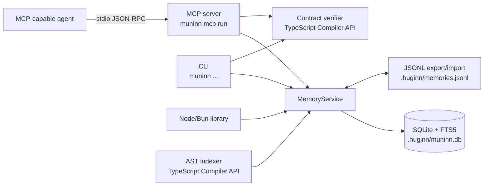

# Muninn

Persistent **semantic and symbol memory** for AI coding agents.

Muninn stores the things a coding session learns — architectural decisions, conventions,
discoveries, bugfixes — next to the symbols they refer to, in a single SQLite file that lives
with the project. It speaks **MCP** so any agent can save and query it, and it exposes the same
engine as a plain Node/Bun library and a CLI.

It used to live inside [Huginn](https://github.com/dahch/huginn); it is now an independent
package with no dependency on the orchestrator.

## Overview

- **Observations with categories** — `decision`, `convention`, `discovery`, `bugfix`,
  `architecture` — searchable with SQLite **FTS5 + BM25** ranking.
- **Decision supersession** — saving a decision with `supersedesTopicKey` atomically marks the
  project's active decisions with that topic key as `superseded`, linking each to its replacement.
  Search and context hide superseded observations by default; pass `includeSuperseded` to see them.
- **A symbol graph** — the TypeScript Compiler API extracts files, functions, classes,
  interfaces and modules from your sources, plus the `imports`/`calls`/`extends`/`implements`/
  `references` edges between them, and links observations to symbols.
- **MCP tools** for agents: `muninn_context`, `muninn_save`, `muninn_search`,
  `muninn_link_symbol`, `muninn_inspect_symbol`, `muninn_verify_contract`, `muninn_stats`.
- **Contract verification** — the same TypeScript execution-contract check as a CLI command
  (`muninn check`) and as the `muninn_verify_contract` MCP tool.
- **JSONL sync** — export/import the whole memory as portable line-delimited JSON.
- **Local-first and self-contained** — no embeddings, no network, no server: one SQLite file
  and one process.

## Prerequisites

- Node.js 20 or newer (the published package also runs under Bun)
- A C/C++ toolchain for `better-sqlite3`'s native module when a prebuilt binary is unavailable
- Git only if you want repository discovery and sanitized remote metadata; Muninn works outside a repository

## Getting Started

```sh
npm install -g @dahch/muninn     # CLI + MCP server
# or as a library
npm install @dahch/muninn
```

From a checkout, install the locked dependencies and initialize memory for this repository:

```sh
npm ci
npm run build
node dist/cli.js memory init --project .
```

## CLI

```sh
muninn memory init   [--db <path>] [--project <path>]
muninn memory search <query> [--category <cat>] [--limit <n>] [--project <path>]
muninn memory sync   [--import] [--file <path>] [--project <path>]
muninn memory index  [files...] [--project <path>] [--db <path>]

muninn check [files...] [--project <path>]

muninn mcp run [--db <path>] [--project <path>]
```

The database resolves to `<git-root>/.huginn/muninn.db` inside a repository and to
`~/.huginn/muninn.db` outside one. `--db` overrides it; `:memory:` is accepted for tests.
Both the database file and the project record are resolved from the **same** root, so
`--project X` can never write into another project's database.

## MCP

Register Muninn with any MCP-capable agent. For example, a Claude Code / Codex / Cursor config
(`mcpServers`):

```json
{
  "mcpServers": {
    "muninn": {
      "command": "muninn",
      "args": ["mcp", "run", "--project", "/absolute/path/to/repo"]
    }
  }
}
```

OpenCode uses the same shape under the `mcp` key with `"type": "local"` and a `command` array.
Huginn's `huginn setup` writes this for you in every runtime it knows about.

```sh
muninn mcp run --project .
```

The `muninn_save` tool accepts `supersedesTopicKey` / `supersedes_topic_key`, and
`muninn_search` / `muninn_context` accept `includeSuperseded` / `include_superseded`. Existing
calls keep working: replacement is opt-in and retrieval excludes superseded observations by
default.

## Architecture

Muninn is one `MemoryService` core with three adapters: the CLI, the MCP stdio server, and the
library. Storage is a single embedded SQLite database with FTS5. The AST indexer writes through the
service/database boundary; contract verification is a separate read-only TypeScript pass.



See [`DESIGN.md`](./DESIGN.md) for the schema, service transactions, MCP validation pipeline, CLI
parsing, contract verifier and indexer internals.

## Library

```ts
import { MemoryService, indexFilesIntoMuninn } from "@dahch/muninn";

const memory = new MemoryService({ projectRoot: process.cwd() });

memory.saveObservation({
  category: "decision",
  title: "Auth is a port",
  content: "Tokens are validated behind an AuthPort so the transport can change.",
  topicKey: "auth-boundary",
  symbols: ["src/auth/port.ts"],
});

// Replaces earlier active decisions with the same topic key in this project.
memory.saveObservation({
  category: "decision",
  title: "Auth is a middleware boundary",
  content: "Tokens are validated in middleware before any handler runs.",
  topicKey: "auth-boundary",
  supersedesTopicKey: "auth-boundary",
});

// Superseded decisions are hidden unless explicitly requested.
const history = memory.search({
  query: "token validation",
  includeSuperseded: true,
});

indexFilesIntoMuninn(memory, ["src/auth/port.ts"], { projectRoot: process.cwd() });

for (const hit of memory.search({ query: "token validation", limit: 5 })) {
  console.log(hit.category, hit.title, hit.rank);
}

memory.close();
```

Subpath entry points are available for narrower imports:

| Import | Contents |
|---|---|
| `@dahch/muninn` | everything below |
| `@dahch/muninn/db` | SQLite client, schema, path resolution, project records |
| `@dahch/muninn/service` | `MemoryService` (save, search, context, linking, sync, stats) |
| `@dahch/muninn/indexer` | AST symbol/dependency extraction and indexing |
| `@dahch/muninn/mcp` | MCP server, tool registry, bounded stdio transport |
| `@dahch/muninn/contracts` | TypeScript contract verification |
| `@dahch/muninn/util` | terminal-text sanitizer |

## Environment Variables

Muninn has no required environment variables. Configuration is passed as CLI flags or
`MemoryService` options.

| Variable | Type | Default | Purpose |
|---|---|---|---|
| `MUNINN_DEBUG` | string (presence is enough) | unset | Emit `[muninn] mcp run` lifecycle diagnostics on stderr, including stdin-close shutdown messages. |
| `HUGINN_DEBUG` | string (presence is enough) | unset | Legacy alias for `MUNINN_DEBUG`, retained for Huginn compatibility. |

## Security notes

- Every path Muninn writes to — the SQLite file and the JSONL export — is screened: a symlink on
  the final component is refused, and a project-relative path must resolve inside the project, so
  a repository cannot redirect the write outside itself (the `src/util/path-safety.ts` rule, with
  the tests in `test/db.test.ts` and `test/service.test.ts`).
- The MCP stdio transport is bounded and survives a dead parent instead of crashing or hanging.
- MCP tool inputs are validated with zod; unknown tools and bad arguments fail closed.

## Available Scripts

```sh
npm run dev        # run src/cli.ts directly with Bun
npm run build      # tsc -> dist/ (+ schema.sql, +x cli.js)
npm test           # vitest run (storage, service, indexer, MCP, CLI)
npm run test:watch # vitest in watch mode
npm run typecheck  # tsc --noEmit
npm run prepublishOnly  # build + test + typecheck (npm lifecycle hook)
```

Run the built CLI without installing it globally:

```sh
node dist/cli.js memory init --project .
node dist/cli.js memory search "auth boundary" --project .
```

### Releasing

Publishing is tag-driven, but only once the package exists. The **first** publish is manual, from a
logged-in machine, because npm's trusted publishing attaches to a package page that has to exist first:

```sh
npm login
npm run build && npm publish   # 0.1.0, once
```

After that, configure the trusted publisher on npm (repository `dahch/muninn`, workflow
`publish.yml`) and tagged releases need no token at all: `git tag v0.1.1 && git push origin v0.1.1`
runs the workflow, which checks the tag against `package.json`, builds, tests and publishes over
OIDC. A run whose version is already on npm skips the publish step and refreshes the GitHub release
instead, so re-tagging to fix a message stays safe. The release job copies the matching version
section from [`CHANGELOG.md`](./CHANGELOG.md).

## Project Structure

```text
src/
  cli.ts                 argument parsing, command routing, process entry point
  commands/              memory (init/search/sync/index), mcp run, check
  db/                    SQLite client, schema.sql, path and project resolution
  service/               MemoryService: save, search, context, links, sync, stats
  indexer/               TypeScript/JavaScript AST symbol and dependency extraction
  mcp/                   MCP server, tool registry, Zod schemas, bounded stdio transport
  contracts/             in-process TypeScript contract verification
  util/                  terminal-text sanitizer and path-safety helpers
test/                    Vitest integration suites for db, service, indexer, MCP, CLI, contracts
```

## Documentation

- [`SPEC.md`](./SPEC.md) — product behaviour, domain model, use cases and constraints.
- [`DESIGN.md`](./DESIGN.md) — technical design, schema, data flow and internals.
- [`ADR.md`](./ADR.md) — architecture decision records, including which decisions are not yet implemented.
- [`CHANGELOG.md`](./CHANGELOG.md) — release notes.
- [`AGENTS.md`](./AGENTS.md) — repository conventions for coding agents; no `.opencode/agents/` are defined.

## Contributing

Keep changes aligned with the current contract: update both `src/db/schema.sql` and the `SCHEMA_SQL`
fallback in `src/db/client.ts`, add or update a Vitest suite under `test/`, and run
`npm run build && npm test && npm run typecheck` before opening a pull request. Add a new ADR for a
new architectural decision instead of rewriting an existing one.

## License

MIT © Daniel Hernández
