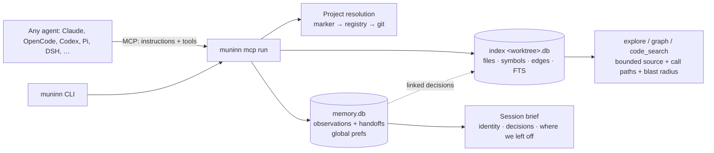

# Roadmap: Muninn as the portable memory + code graph for any agent

> **Status: implemented in 0.4.0, with the gaps listed below.** This document started as the
> 0.2.1 audit and plan; it is kept as the record of what shipped and what remains. The current
> contract is `SPEC.md` + `DESIGN.md` + ADR-19 to ADR-27.
>
> | Phase | State | Evidence |
> |---|---|---|
> | 0 — decisions and migrations | ✅ done | `PRAGMA user_version` migrations (schema v4), ADR-19…24 |
> | 1 — identity and portability | ✅ done | `.muninn/project.json`, registry, `~/.muninn/projects/<uid>`, Git common root, `muninn migrate`, `muninn project` |
> | 2 — capture and continuity | ✅ done | `handoffs` table, `muninn_handoff`, `end-session`, `seed`, brief section, MCP instructions |
> | 3 — TS/JS graph and tools | ✅ done | `code_*/` tables, incremental indexer, `muninn_explore`, `muninn_graph`, `muninn_code_search` |
> | 4 — multi-language graph | ✅ done | Tier C heuristic + optional tree-sitter WASM (Python, Go, Rust, Java, C/C++, C#, Ruby, PHP, Bash) |
> | 5 - agent activation | done | instructions, rules v2, muninn doctor, muninn hook, Claude hooks installer; DSH manual catalog entry + doctor detects dsh-mcp |
> | 6 - hardening and release | done | 622 tests, typecheck and build green; global scope, snapshots, watch and benchmarks shipped |
>
> Remaining work: per-agent hook installers beyond Claude, DSH auto-configuration (its
> dsh-mcp plugin stores servers in its own UI, so the catalog entry is manual), and
> large-repository benchmarks beyond the 1,000-file baseline.

## 1. The problem this plan solves

Muninn 0.2.1 is a good **storage and retrieval engine**. It is not yet a **memory system**:
its databases are empty, its index only understands TypeScript/JavaScript, and no agent
receives project context automatically. The goal is the opposite of that:

1. A new session in *any* agent (Claude, OpenCode, Command Code, Pi, Codex, DSH desktop,
   Gemini, …) opens on a folder and immediately knows **what the project is, what was
   decided, what was in progress, and where the relevant code lives** — without re-reading
   the repository.
2. The same memory works for any kind of project: any language, with or without Git, mono-
   repo or single script, worktree or clone.
3. The code index is a **graph**, not a symbol table: files, symbols, imports, calls,
   inheritance, tests, with tools that answer "who calls this", "what breaks if I change
   it", "where is this flow" in one bounded call.

## 2. Audit of 0.2.1 (what holds and what does not)

Baseline verified on this machine: `npm run typecheck` passes, `npx vitest run` is
**570 tests / 10 files, all green**, `src + test` ≈ 20.8k lines. Version `0.2.1`,
branch `main`, last commit `8fa6d52`.

### 2.1 What already works

| Area | State | Where |
|---|---|---|
| Project-scoped observations | ✅ 5 categories, FTS5 + BM25, limit/clamp | `src/db/schema.sql`, `src/service/memory-service.ts` |
| Decision supersession | ✅ atomic, opt-in, hidden by default | `saveObservation`, `search`, `getContext` |
| Read-only session brief | ✅ bounded, deterministic, fail-open, path selection | `readSessionBrief`, `muninn_bootstrap`, `memory brief` |
| JSONL export/import | ✅ atomic, path-screened, idempotent by ID | `syncToDisk`, `importFromDisk` |
| Agent setup | ✅ 14 destinations (DSH manual), JSON + Codex TOML + portable + marked rules | `src/setup/` |
| MCP surface | ✅ 13 tools, Zod-validated, bounded stdio | `src/mcp/server.ts` |
| Safety | ✅ symlink/containment screens, atomic writes, 0600/0700 | `src/util/path-safety.ts` |

### 2.2 What does not meet the goal

| # | Gap | Evidence |
|---|---|---|
| G1 | **Agent sessions capture nothing.** Across the 6 project databases there are 31 observations and 131 entities — and they come from the Huginn orchestrator cycle (ADR imports + iteration discoveries), not from agent sessions. The projects with real ongoing work (`lumion`, `heimdall`, `default-workspace`, `muninn` itself) have **0**. | `sqlite3` over `~/.huginn/muninn.db`, `default-workspace`, `heimdall`, `lumion`, `odrerir`, `test-huggin`, `test-huggin2`; titles are `ADR-N: …` and `iter N: …` |
| G2 | **Project identity is `root_path`, exactly.** Moving, renaming or recloning a project creates a new project row; memory is orphaned. | `projects.root_path UNIQUE`, `ensureProject` |
| G3 | **Non-Git projects share one database.** All of them write into `~/.huginn/muninn.db`; there is no per-project isolation. Verified by initialising `/tmp/muninn-probe`. | `resolveDatabasePath` fallback |
| G4 | **Worktrees fragment memory.** `findGitRoot` stops at the worktree root (`.git` is a file there), so each worktree gets its own `.huginn/muninn.db`; the remote is also unreadable because `readFile(<worktree>/.git/config)` does not exist. | `findGitRoot`, `tryGetGitRemote` |
| G5 | **`--project` may be a subdirectory.** The DB resolves from the Git root but the project row is inserted for the given subdirectory — one repository becomes N projects in one DB. | `getDatabase(projectRoot)` vs `ensureProject(rootPath: projectRoot)` |
| G6 | **`calls` edges are never emitted**, although the schema allows them. | `DependencyRelationType`, ADR-11 |
| G7 | **`extends` / `implements` targets are raw source text** (`"Error"`, `"AuthPort"`), not resolved to definitions, so those edges dangle on phantom entities. | `ast-indexer.ts` heritage clauses |
| G8 | **Line spans are extracted but never persisted.** No `start_line`/`end_line`, no signature, no doc, no language. Source slices are impossible from the graph. | `entities` schema vs `ExtractedSymbol.startLine` |
| G9 | **Only TS/JS is indexed.** `SUPPORTED_EXTENSIONS` is 8 extensions; `findSourceFiles` walks the same set and does not honour `.gitignore` (only a hard-coded ignore list missing `vendor/`, `target/`, `.venv/`, `.next/`…). | `ast-indexer.ts`, `commands/memory.ts` |
| G10 | **No code search or graph tools for agents.** MCP exposes prose-memory tools plus `inspect_symbol` (exact/suffix/prefix `LIKE`); there is no symbol search, callers, callees, impact, files or source slice. | `TOOL_REGISTRY` |
| G11 | **Indexing is manual CLI only.** No incremental hashing, no staleness detection, no watcher, no `index` tool. Agents never run it. | `memory index` |
| G12 | **No handoff / session continuity.** Nothing records "where we left off", open questions, next steps, or which agent/session wrote an observation. | observation categories |
| G13 | **No activation.** The MCP `initialize` response carries no `instructions`; the rules block is only written when `setup --agent` is run; nothing forces a bootstrap. | `createMcpServer`, `setup/rules-target.ts` |
| G14 | **This machine is partially wired and already stale:** Claude and OpenCode point at `muninn mcp run`; Pi still points at the legacy `huginn` command pinned to `lumion`; Codex has no Muninn entry; the DSH desktop profile has **no MCP plugin bundle at all**, so DSH cannot reach Muninn today. | `~/.claude.json`, `~/.config/opencode/opencode.json`, `~/.pi/mcp.json`, `~/.codex/config.toml`, `~/.dsh/profiles/desktop/package.json` |
| G15 | **Portability across machines is manual JSONL.** No repo snapshot, no merge strategy, no clone story. | `syncToDisk` only |

### 2.3 Root cause

The engine is retrieval-complete and capture-empty. Everything the user asks for is blocked
by three decisions that were never made: **what a project *is*** (identity independent of
path), **how context arrives at a session** (activation), and **what the code index *is***
(a resolved graph, language-agnostic). The rest is implementation.

## 3. Target design



### 3.1 Identity: one project, many paths

- `.muninn/project.json` marker at the project root: `{ "uid": "<uuid>", "name": "…" }`.
  Committed, tiny, and the only thing a repo needs to carry.
- Resolution order: `--project` → `MUNINN_PROJECT` → nearest `.muninn/project.json` walking up
  → Git **common dir** (`git rev-parse --git-common-dir`, so worktrees unify) → registry match
  on realpath prefix → fallback: create a project record for the cwd.
- Registry `~/.muninn/registry.json` (or a `registry.db`): uid, name, kind (git/non-git),
  known paths, git remotes, last seen, languages. Never authoritative over the marker, only a
  fast lookup and a `doctor` input.
- A project row stores `uid`, `aliases`, `git_remotes[]`, `languages[]`, `last_seen_at`,
  `first_commit` (optional, Git only).

### 3.2 Storage: outside the repository, isolated per project

Proposed (needs the ADR listed in §7):

```
~/.muninn/
  projects/<uid>/
    memory.db          # observations, handoffs, links, scope=project
    index/<worktree>.db # code graph for one worktree (content differs per branch)
    memory.jsonl       # optional deterministic snapshot for Git
  global.db            # cross-project preferences and conventions
  registry.json
```

Reasons: a non-Git folder gets its own memory; a clone or a move keeps it; `git status`
stays clean; worktrees share memory but not code; and the repo only carries the marker.
The current "DB must live inside the project" rule (`assertDocPath` containment) is replaced
by "the project may not redirect a Muninn path outside `~/.muninn`" — the same symlink
screen, a different containment root.

### 3.3 Memory model v2

- Keep the five categories for compatibility.
- Add `observations.scope` (`project` | `global`), `agent`, `session_id`, `confidence`,
  `valid_from`, `tags` (JSON), and an optional `files` link list (replaces symbol-only links
  for non-code projects).
- Add the missing kinds needed to avoid re-reading the repo: `handoff`, `open_question`,
  `task`, `constraint`, `glossary`, `preference`. Implemented as a new category set with an
  idempotent table rebuild, not a silent CHECK change.
- **Handoff record** (the key object): `goal`, `state` (done / doing / blocked), `files_touched`,
  `decisions` (links to observations), `open_questions`, `next_steps` (ordered), `agent`,
  `session_id`, timestamps. One active handoff per project; a new one supersedes the previous.
- **Seed/backfill**: `muninn seed` reads `README`, `AGENTS.md`, `ADR.md`, `CHANGELOG.md`,
  manifests and `git log`, and emits a *review packet* (deterministic extracts: project charter,
  stack, commands, ADR titles/status). The agent turns it into observations with `muninn_save`.
  No model runs inside the engine (keeps the non-goal).
- **Global scope**: preferences and conventions that apply to every project are merged into
  every brief, after project content (bounded).

### 3.4 Code graph v2

New tables (legacy `entities` stays as a compatibility view until 0.6):

```sql
code_files(id, project_id, index_root, path, language, content_hash, bytes, lines,
           is_test, is_generated, indexed_at)
code_symbols(id, project_id, file_id, name, qualified_name, kind, start_line, end_line,
             start_col, signature, doc, visibility, is_exported, parent_symbol_id, language)
code_edges(id, project_id, src_id, dst_id, kind, line, confidence, target_name, resolution)
code_symbols_fts(name, qualified_name, doc, signature)  -- content= external
code_files_fts(path)
code_index_state(project_id, index_root, path, hash, indexed_at, indexer_version)
```

- `kind`: `imports, calls, extends, implements, references, contains, exports, tests, decorates`.
- `confidence`: `exact` (resolved by the compiler/grammar) or `heuristic` (name match);
  `resolution`: `resolved | ambiguous | external | unresolved`. Output never hides this.
- Kinds follow language: `function, method, class, interface, type, enum, struct, trait, module,
  field, constant, macro`.
- Incremental by `content_hash`; a file change deletes and re-inserts only its rows.

**Extraction adapters** (`LanguageAdapter`):

| Tier | Languages | Engine | Fidelity |
|---|---|---|---|
| A | TS/JS/TSX/JSX | TypeScript Compiler API (existing) | exact imports, spans, local calls, heritage |
| B | Python, Go, Rust, Java, Kotlin, C, C++, C#, Ruby, PHP, Swift, Dart, Scala, Lua, Bash, SQL, Vue/Svelte/Astro | `web-tree-sitter` + WASM grammars (optional pack) | structural, heuristic calls |
| C | anything with a known extension | zero-dependency heuristic scanner (function/class/import/require patterns per family) | names + imports, best effort |

Tier C guarantees that no project is blank; Tier B is the real answer for "any language";
Tier A stays the most precise. Grammar packs are local, lazy-loaded, and never required.

**Resolution pass** (after extraction, per project):

1. relative / package imports → file ids (TS paths & package.json exports; Go modules;
   Python module paths; Rust `mod`; JVM packages).
2. heritage (`extends`/`implements`) → same file → same project unique name → imported files;
   otherwise keep the raw name with `resolution=unresolved`.
3. calls → local scope → imported names → unique project name; ambiguous names keep both,
   marked `ambiguous`.
4. tests → production symbols by path convention and imports.

**Queries** (all bounded: max depth 3, max nodes 200, max chars 20k, deterministic order):
symbol search (FTS + prefix + fuzzy), node by symbol or file (with line-numbered source slice),
callers, callees, impact radius, implementations/extends, file tree, import cycles, affected
tests, path from A to B.

### 3.5 MCP surface

Follow the CodeGraph lesson: one strong tool, a small menu.

- `muninn_bootstrap` — unchanged name, richer output: identity + stack + commands + active
  decisions + constraints + **where we left off** + open questions + next steps + area map.
- `muninn_explore` — **flagship**: query/symbol/file → verbatim source groups, call paths,
  blast radius, related decisions. One call replaces "read 15 files".
- `muninn_graph` — `relation: callers | callees | impact | implementations | imports | cycles | tests`.
- `muninn_code_search` — symbol/file search with kind/language filters.
- `muninn_save`, `muninn_search`, `muninn_context`, `muninn_link_symbol`, `muninn_stats` — kept.
- `muninn_handoff` — `mode: start | checkpoint | end`, writing the handoff record.
- `muninn_project` — `action: use | status | index`; lets an agent pick a project when the cwd
  is not it, and refresh a stale index.
- `muninn_inspect_symbol` — becomes an alias of `muninn_graph`.
- `muninn_verify_contract` — unchanged (TS-only, documented as such).

### 3.6 Activation: the context arrives by itself

1. **MCP `initialize.instructions`** — every client receives the project name, root, and the
   three rules (bootstrap, save, handoff) before the first prompt. Protocol-level, no
   tool-calling discipline required.
2. **Rules blocks** — updated with the handoff rule; one block per agent from `setup`.
3. **Hooks where the agent supports them** (`setup --hooks`): session start prints the brief,
   session end writes a handoff skeleton (files from `git status`, decisions from the session).
   `muninn end-session` works even if the agent forgot.
4. **`muninn doctor`** — per agent: config present and valid, binary resolves, server answers,
   which project it resolves, index freshness, memory counts. One command to answer "why did
   my other agent not see the memory?".

### 3.7 Portability

- Deterministic JSONL snapshot in `.muninn/memory.jsonl` (optional, committable), merge by
  id + `updated_at` (last writer wins per record), tombstone for deletions.
- `muninn export/import --merge` for moving a project between machines; uid + git remote as
  identity across paths.
- No network, no telemetry, no embeddings (unchanged non-goals).

## 4. Phases

Each phase is independently shippable, keeps the suite green, and follows the repository
invariants (schema.sql ↔ SCHEMA_SQL, idempotent migrations, Zod on every MCP input,
`assertDocPath`, ADR/CHANGELOG updates).

### Phase 0 — Decisions and migration scaffold (2–3 days)

- ADR: project identity (marker + registry), storage outside the repo, category v2, code
  graph schema, MCP instructions, `entities` compatibility view.
- `PRAGMA user_version` migration runner; convert the two ad-hoc `ALTER TABLE`s.
- Update `SPEC.md` non-goals: they currently forbid new tables, which this plan needs.

**Exit:** documents merged, `user_version` in place, suite green.

### Phase 1 — Project identity and portability (4–6 days)

- `.muninn/project.json`, resolution chain, registry, `muninn project` group
  (`resolve`, `register`, `list`, `forget`, `rename`).
- `memory.db` per uid under `~/.muninn/projects`; per-worktree code index path.
- Migrate existing `.huginn/muninn.db` and the shared home DB with `muninn migrate`
  (idempotent, backed up, reports every project it moves).
- Fix G2–G5: Git **common dir**, subdirectory `--project` normalised to the project root,
  non-Git isolation, aliases for moved paths.

**Acceptance:** a non-Git folder, a Git repo, and two worktrees of the same repo all resolve to
the same project uid and separate memory; moving the folder keeps the memory; `muninn project
resolve --json` answers from any subdirectory.

### Phase 2 — Capture and session continuity (5–7 days)

- Category v2 + handoff record + `scope`, `agent`, `session_id`, `files`.
- `muninn_handoff`, `muninn seed`, `muninn end-session`, brief rendering of "where we left off".
- Rules block v2; `setup --hooks` for agents with hooks; MCP `initialize.instructions`.
- Global scope merged into the brief.

**Acceptance:** a scripted end-to-end run (init → seed → work → end-session) leaves a handoff;
a *different* agent started in the same folder gets a brief containing the last handoff, the
open questions and the next steps, with zero repository reads.

### Phase 3 — Code graph v1, TS/JS precise (6–8 days)

- Schema v2, `content_hash` incremental indexing, spans/signature/doc, FTS.
- TS adapter rewritten: persist spans, resolve heritage and imports, emit `calls` with
  confidence, detect tests.
- Graph queries + `muninn_explore`, `muninn_graph`, `muninn_code_search`, `muninn_project`.
- `entities` compatibility view so old APIs and the 570 tests keep passing.
- Staleness check on tool calls + `muninn_project index`.

**Acceptance:** on a 5k-file TS repo, cold index < 60 s, incremental < 3 s, query p95 < 50 ms;
`explore` answers "who calls X" and "what breaks if I change Y" with bounded source; no full
repository read at query time.

### Phase 4 — Multi-language graph (10–14 days)

- `LanguageAdapter` registry, Tier C heuristic scanner (works with zero new dependencies),
  then Tier B `web-tree-sitter` packs for the top 15 languages.
- Per-language import/module resolution and heritage resolution.
- `.gitignore` (via `git check-ignore` when Git is present, parsed otherwise), default excludes
  for every ecosystem, binary and size caps, monorepo detection.

**Acceptance:** Python/Go/Rust/Java/Ruby sample repos produce non-empty graphs with imports
and heuristic call edges; no crashes on minified, generated or binary files; `.gitignore`
is honoured in non-Git directories.

### Phase 5 — Agent-agnostic activation (4–5 days)

- Add DSH and the missing catalog entries; detect installed agents; per-agent rules and hooks.
- `muninn doctor` with a cross-agent matrix report; `setup --status` includes reachability and
  project resolution, not just file shape.
- Fix stale configs on upgrade (Pi's legacy `huginn`, pinned project paths) with a reported,
  non-destructive replacement.

**Acceptance:** the same brief is reachable from at least Claude, OpenCode, Codex, Pi and DSH;
`doctor` names exactly what is broken when it is not.

### Phase 6 — Hardening, docs, release (4–5 days)

- Benchmarks, DB size caps, concurrency (several agents indexing/reading at once), Windows.
- Full docs (README, DESIGN, SPEC, ADR, CHANGELOG), deprecation of `.huginn`.
- Release 0.3 (Phases 1–2), 0.4 (Phase 3), 0.5 (Phases 4–5).

**Total:** roughly 6–8 weeks of part-time work, with usable increments after Phase 2 and
Phase 3.

## 5. Success metrics

| Metric | Target |
|---|---|
| Time to first useful context in a new agent session | brief returned in < 300 ms, < 8k chars |
| Questions answered without reading the repo | ≥ 8 of 10 scripted questions per sample project |
| Sessions that leave a handoff | ≥ 80% (hook + rule + `end-session`) |
| Capture volume after 30 days | ≥ 20 observations and 1 handoff per active project |
| Index cold / incremental | < 60 s / < 3 s on 5k files |
| Query latency | p95 < 50 ms |
| Cross-agent parity | same brief from 5 agents on the same project |
| Graph resolution | ≥ 90% imports, ≥ 70% calls on TS; ≥ 50% calls on Tier B |

## 5b. Measured baseline

Synthetic TypeScript repository, 1,000 files / 3,000 symbols / 7,000 edges (single process, cold CLI):

| Measurement | Result |
|---|---|
| Cold full index | 1.0 s wall (652 ms indexing) |
| Warm incremental index | 0.4 s wall (no changed files) |
| Callers query (process included) | 0.34 s |
| Peak RSS while indexing | ~200 MB |

Re-run with the same shape before changing the indexer; the numbers above are the regression floor.

## 5c. Deployed on this machine (0.4.0)

Legacy databases were migrated non-destructively and every active project was seeded and indexed
with the built CLI against the real home directory (no agent configuration was modified, no project
marker was written):

| Project | Memories | Files | Symbols | Edges |
|---|---|---|---|---|
| muninn | 52 | 60 | 610 | 11,576 |
| odrerir | 37 | 119 | 1,357 | 15,874 |
| lumion | 52 | 75 | 1,313 | 8,201 |
| heimdall | 19 | 34 | 141 | 2,387 |
| english-forge | 12 | 123 | 937 | 9,217 |
| polonium | 3 | 37 | 250 | 1,257 |
| test-argon/whole-system | 15 | 80 | 345 | 3,073 |
| test-huggin | 25 | 12 | 64 | 1,411 |
| test-huggin2 | 5 | - | - | - |

Migrations copied 40 legacy observations, 1,210 entities, 205 links and 1,899 dependencies. The
legacy .huginn files are byte-identical afterwards. doctor reports project resolution, memory,
graph and agent-config state per project.

## 6. Risks and how they are handled

- **SQLite CHECK migration** for categories: table rebuild inside one transaction, rows
  preserved, verified by a migration test with a populated legacy database.
- **tree-sitter WASM size and startup**: lazy per-language loading, optional pack, Tier C
  fallback, no network at runtime.
- **Storage outside the repo** reverses a security decision: new ADR, `~/.muninn` created
  `0700`, files `0600`, symlinks refused, registry never writable from a project.
- **Breaking the 570-test contract**: keep `entities` as a view, keep every existing MCP tool
  and payload shape, add tests before refactoring.
- **Worktree semantics**: memory shared per repository, code graph per worktree; documented
  and tested with a real `git worktree`.
- **Index cost on huge repos**: caps, ignore rules, incremental hashing, progress reporting,
  and a "too large, index a subdirectory" mode.
- **Doing too much at once**: each phase has an exit criterion and can ship alone.

## 7. Decisions needed before Phase 1

1. **Where memory lives**: `~/.muninn/projects/<uid>/` (recommended) vs `.muninn/` inside the
   repo. The first makes non-Git and clones first-class; the second keeps everything in the
   repository but puts a database under version control.
2. **Multi-language start**: Tier C first (zero dependencies, works everywhere, less precise)
   then Tier B packs (recommended), or jump straight to tree-sitter.
3. **Capture policy**: handoff mandatory at session end (recommended) vs observations only.
4. **Naming**: migrate to `.muninn` and keep `.huginn` as a read-only legacy alias, or keep
   `.huginn` forever.

## 8. Explicitly out of scope

Embeddings or vector search, network services, telemetry, running a model inside the engine,
generating summaries automatically, checking whether an agent actually connected, and
replacing an agent's own tooling (Muninn supplies context, not a shell).
### Tier B measurements (tree-sitter)

| Project | Language | Files | Symbols | Wall time |
|---|---|---|---|---|
| odrerir | C/C++ | 117 | 1,357 | 1.0 s |
| lumion | Rust | 72 | 1,313 | 1.1 s |
| english-forge | Python | 82 | 937 | 0.9 s |

TypeScript/JavaScript stay on the Compiler API (heimdall: 34 files / 141 symbols in 0.17 s).
